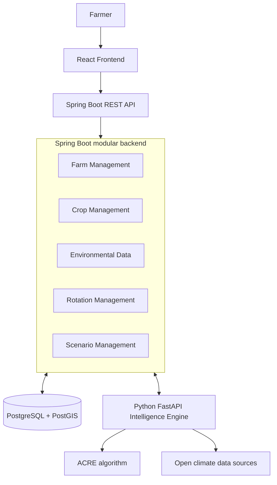

# سنبلة | Sunbula

**A decision-support platform that helps farmers choose what to plant, season after season.**

Sunbula analyzes a farm's location, soil and priorities together with historical climate data, then generates and compares multi-season crop rotation plans, with a clear explanation for every recommendation.

---

## The problem

Farmers usually decide what to plant based on habit and tradition, not data. The decision has to balance three competing goals:

- **Water:** high-demand crops in dry regions waste scarce water.
- **Soil health:** repeating crops from the same family drains nitrogen and builds up pests and disease.
- **Income:** the most profitable crop is often the worst for water and soil.

Climate and soil data exist, but they are complex and rarely reach farmers in a usable form.

## What Sunbula does

1. The farmer registers a farm: location, area, soil type, pH and available irrigation.
2. The farmer sets priorities (water, soil, climate, economics) as weights.
3. Sunbula analyzes the farm's historical climate (temperature, rainfall, solar radiation).
4. The **ACRE** engine (Adaptive Crop Rotation Engine) generates feasible 4-season rotations.
5. Three plans are returned and ranked: **water-efficient**, **soil-health-focused** and **economic-return-focused**.
6. Each plan comes with an explanation, its data sources and its limitations.
7. The farmer can simulate a hypothetical drought or heat shock on any plan.

## Scoring

```
Score = Ww × Water + Ws × Soil + Wc × Climate + We × Economics
```

All components are in `[0, 1]` (higher is better). Ww, Ws, Wc, We are the farmer's weights.

## Scientific transparency

- Every environmental variable is stored with its unit, period, spatial resolution, source, processing method and quality note.
- Missing data is marked **unknown**. It is excluded from the score (weights are renormalized) and never silently treated as zero.
- Historical observations are never presented as forecasts.
- Climate shock simulations are labeled **hypothetical**.
- Crop parameters are flagged as unreviewed until an agriculture specialist approves them.

## Architecture



| Layer | Responsibility |
|---|---|
| React | Farm setup, environmental dashboard, plan comparison, explanations |
| Spring Boot | REST API, farm and crop management, analysis lifecycle, talks to Python |
| Python FastAPI | Climate data processing, indicators, rotation generation, scoring, scenario simulation |
| PostgreSQL + PostGIS | Farms, soil, crops, analyses, plans, data-source metadata |

## Repository structure

```
Sonbola/
├── sunbula-frontend/   # React web app
├── backend/            # Spring Boot modular backend (farm, crop, environment, rotation, scenario)
├── intelligence/       # Python FastAPI service (ACRE engine + climate data)
├── docs/               # Architecture and notes
├── docker-compose.yml
└── README.md
```

## Run locally

```bash
docker compose up --build
```

- Frontend: http://localhost:3000
- API: http://localhost:8080/api/v1
- Intelligence service docs: http://localhost:8000/docs

Run each part separately:

```bash
# Intelligence service
cd intelligence && pip install -r requirements.txt && pytest && uvicorn app.main:app --reload

# Backend (needs PostgreSQL with PostGIS)
cd backend && mvn spring-boot:run

# Frontend
cd sunbula-frontend && npm install && npm run dev
```

## Status

**Working prototype (MVP).** What exists:

- [x] Farm registration and storage
- [x] Climate analysis with full metadata
- [x] ACRE engine with three ranked plans and explanations
- [x] Hypothetical drought and heat simulation
- [x] Automated tests for the intelligence service

**Not done yet (honest limitations):**

- Crop parameters are placeholder defaults pending agriculture-specialist review.
- No field trial with real farmers yet.
- No authentication, interactive maps or historical charts.
- Climate data is gridded and may differ from on-farm conditions.

## Roadmap

1. Specialist review of crop data and a full demo.
2. Pilot with the first group of farmers.
3. Partnership with an agricultural cooperative or extension body.
4. Paid plan, authentication, maps and charts.
5. Crop-residue reuse module (compost, feed, mulch, biochar, biogas) linked to each rotation.

## License

To be decided.
